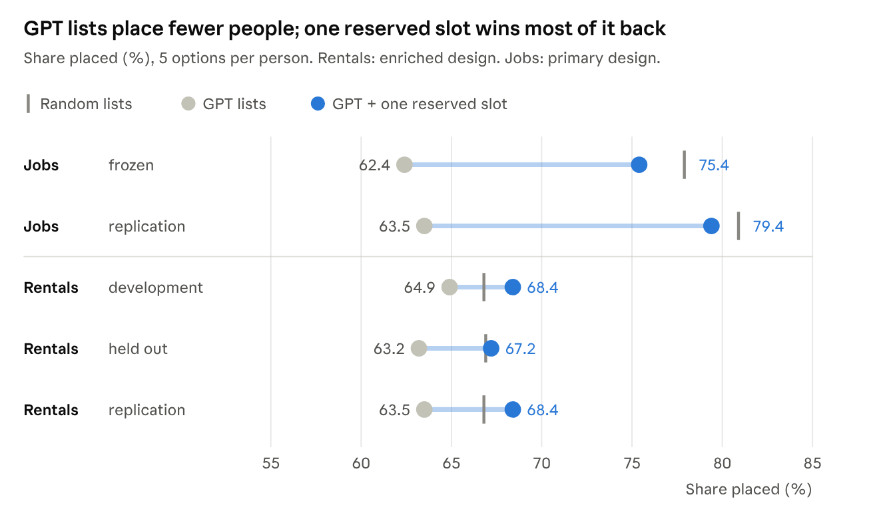
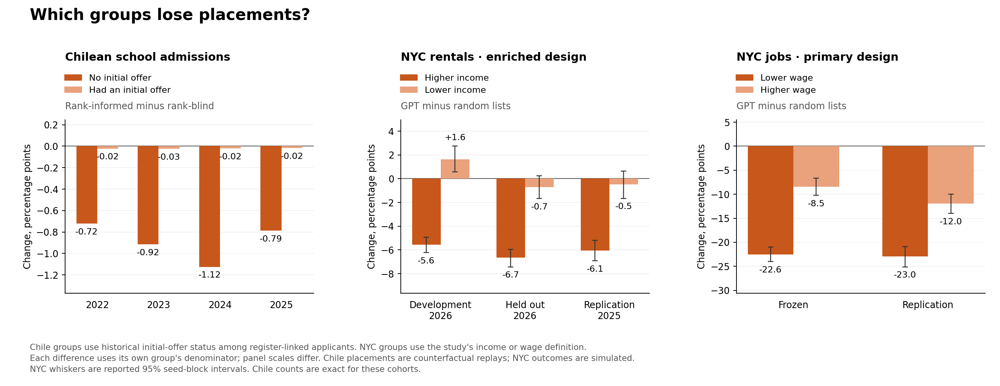
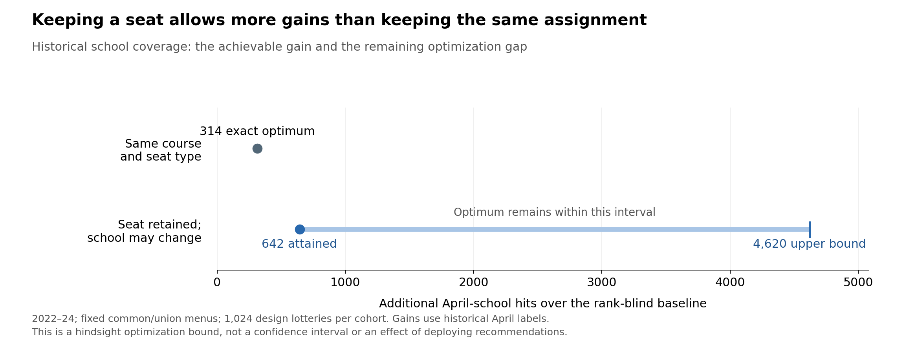

# Headline findings: recommended shortlists in NYC rentals, NYC jobs and Chilean schools

Short version. Full numbers, intervals and caveats are in [`README.md`](README.md).

[17-minute course presentation, narration and technical appendix](../course/final-presentation/README.md)

**Setup.** `gpt-6-luna` picks 5 options per person; we compare against 5 random options on the same markets and clear the market with deferred acceptance. There are two simulation studies:
- **NYC rentals:** [`gpt-luna-rentals/`](gpt-luna-rentals/README.md), 3 windows.
- **NYC job postings:** [`jobs-gpt-frozen/`](jobs-gpt-frozen/README.md), Revelio data, frozen design plus a held-out replication.

The Chile extension uses two logistic classifiers trained on 2019 records and tested on the 2022–25 application cohorts. Reports, priorities, initial offers and April enrollments come from administrative records. Placement under changed menus is a counterfactual replay. [Current Chile results and source tables](chile/README.md)

1. **Coordination improves placement, but does not protect every recipient.** GPT's lists place 2–4 pp fewer people in enriched rentals and 15–18 pp fewer in jobs than random lists. A one-option anchor recovers 3.5–4.9 pp in enriched rentals and 13–16 pp in jobs. The completed [rental access audit](rental-anchor-access/README.md) finds gross exits in every window/design: the held-out enriched anchor adds 449 entrants but loses 37 GPT recipients. A stronger Balanced + GPT policy places another 6.61–12.83 pp across the six rental cells, while covering 3.05–6.06 pp fewer full-information assignments than the anchor; both signs survive the within-cell simultaneous intervals. Balanced menus keep the same lengths but may replace several options. This is a tradeoff between coordinated policies, not a universal impossibility: Balanced + GPT beats random on both mean outcomes. Jobs anchor coverage and individual exits remain unmeasured.

2. **In the NYC simulations, the group with more feasible options has the larger placement decline.** That's higher-income renters (46 feasible listings against 14), who lose about 6 pp. In jobs it's lower-wage seekers (about 21 feasible jobs against 11), who lose about 23 pp.

3. **"More accurate but places fewer" depends on the comparison.**
   - **Rentals:** it holds, with about +8 pp accuracy and −2 to −4 pp placed.
   - **Jobs:** the 5-job coverage advantage is positive in the frozen sample but unresolved in the replication interval. Half-length lists have positive coverage and negative placement differences in both windows.
   - **Chile:** adding rank gains 4,638 April-school hits and loses 1,670 placements across four cohorts. Against first-five, the rank-informed model gains both hits and placements. The baseline changes the conclusion.

4. **GPT widens the lower- vs higher-group gap in missing a better option (T), but for different reasons.**
   - **Rentals:** about +7 to +8 pp. Switching higher-income renters' lists reduces their missed-option rate (86% → 80% in the held-out window). The lower-income change is small in that comparison.
   - **Jobs:** about +4 pp in markets drawn without oversampling, and not significant in the pre-specified stratified design. With the other group on random lists, switching a group's own lists raises misses (lower-wage 75% → 81%, higher-wage 39% → 45%). The Shapley contributions largely cancel in the gap; each includes changes in both groups' outcomes.

5. **Repairs are cheap in jobs.**
   - **Repair cost:** the cheapest stable repair costs about the same under GPT as under random, and slightly less.
   - **Protection:** preventing additional avoidable losses costs about 0 extra. The protected set excludes people worse off even under full-information, seeker-optimal stable matching.
   - **Losers:** about 16–17% of seekers are in that excluded set and still end up worse off after the repair. This guarantee does not protect every incumbent, as the Chile all-order retention rule does.

   These hold with one firm per seeker (the housing convention). The rental runs had no audits.

**Caveats.**
- NYC preferences and allocations are simulated. Chile uses recorded applications and enrollments, with counterfactual allocations under altered shortlists.
- Timing of the jobs analyses (`jobs_manifest.json`, `later_additions`):
  - **T, group switch, protection premium:** named in the shared protocol before the jobs freeze.
  - **Accuracy and capacity/anchor:** added after the frozen-month results, but fixed before the held-out replication. Capacity loss and anchor recovery repeat; the five-job coverage advantage remains uncertain.
  - **Calibrated T and one firm per seeker:** fully post hoc.
  - **Rentals:** the accuracy and capacity analyses are equally post hoc there.
- Jobs T intervals are about ±3 pp, so small effects could be missed.
- "Missed a better option" and "placed" can move in opposite directions, so report both.

# LLM shortlists: strongest results

## The headline numbers

When gpt-6-luna picks the 5 options each person sees, fewer people get placed than with 5 random options. Coordinating one menu position per person recovers much of the loss. NYC differences compare GPT with random lists on the same simulated markets, in percentage points. Anchor gains compare the repaired and original GPT menus. Chile counts applicant-years over the stated cohorts.

| Result | Number | Where |
| --- | --- | --- |
| Fewer job seekers placed | **−15.5 / −17.5** | Jobs, frozen / replication |
| Fewer lower-wage seekers placed | **−22.6 / −23.0** | Jobs, frozen / replication |
| More accurate, yet fewer renters placed | **+8 accuracy, −2 to −4 placed** | Rentals, 3 windows |
| Capacity of the shown lists cut | **−20 to −22** jobs; **−9 to −11** rentals | Both markets |
| One coordinated menu position wins back | **+13 to +16** jobs; **+3.5 to +4.9** rentals | Jobs primary; rentals enriched |
| Anchored GPT vs plain random, rentals | **+1.5, +0.3, +1.6** (mean differences) | Enriched rentals, 3 windows |
| Balanced GPT vs anchored GPT | **+6.61 to +12.83 placed; −3.05 to −6.06 coverage** | All 6 rental window/design cells; unequal edit budgets |
| More placements can include incumbent losses | **449 entrants, 37 exits** | Anchor vs GPT, held-out enriched rentals |
| Gap in missed better options widens (T) | **+7 to +8** rentals; **+4** jobs (natural draws) | Both markets |
| Rank-informed model vs rank-blind | **+4,638 April hits, −1,670 placements** | Chile, 2022–25 counterfactual replays |
| Pupils with no initial offer bear most net loss | **7.4% of linked sample, 76.0% of net placement decline** | Chile |
| Let pupils switch schools while keeping seats | **642 attainable gains vs 314 with the same course and seat type** | Chile, hindsight in the fixed menu family; 3 × 1,024 design lotteries |

Both NYC studies show a reduction in maximum feasible matching on the displayed pairs. The jobs decline is larger in these sampled markets.

## Capacity, and the one-slot repair

Replacing at most one displayed option with an anchor from a maximum feasible matching increases mean placement in these panels. The anchor uses the entire feasible graph and preserves list length. Jobs remain 2.6 and 1.5 pp below random in the two windows. Enriched rentals reach or exceed random in mean placement, but the held-out difference is uncertain. The [new rental follow-up](rental-anchor-access/README.md) measures coverage and individual exits: it does not establish coverage equivalence or retention, and broader balancing places substantially more people than the anchor.

In jobs, GPT's top three postings take 37% of list slots against 27% under random lists.

## Accuracy is not placement, across all three studies

The selected policy comparison has lower placement in every displayed cohort or window. Chile compares rank-informed with rank-blind classifiers; NYC compares GPT with random. Coverage targets and denominators differ, and the jobs replication interval for coverage includes zero.

The earlier 2020–21 Chile benchmark found that both classifiers beat random on coverage and placement. In the current 2022–25 institutional replay, the rank-informed model also beats first-five overall. The rental and jobs results support a concern about the evaluated policies in their own markets. They do not establish a ranking of LLMs against classifiers across different markets.

## Who bears the loss?

The groups differ across studies. Higher-income renters and lower-wage job seekers have the larger placement declines in the NYC simulations. Chile shows a different social concern. The 145,450 linked pupils with no initial offer lose 1,270 placements under rank-informed versus rank-blind menus, accounting for 76.0% of the overall decline.

In the separate 2021 Chile entry-grade replay, 237 of the 309 net lost placements occur among pupils whose own menu stays identical. That locates an externality in the replay. It gives no estimate of the effect of deploying either policy to families.

## Hidden harms: a near-zero gap can be two harms

In jobs, each group's missed-option rate rises when its own lists change and the other group stays on random. This is one contrast from the four policy combinations:

- **Jobs:** the replication's Shapley contributions to the gap are +9.1 [6.6, 11.5] and −6.5 [−8.9, −4.0], summing to T = +2.6. These intervals concern contributions to a between-group gap, not each group's own-list effect.
- **Rentals:** with the other group on random, higher-income renters' missed-option rate falls from 86% to 80%. The corresponding lower-income change is small. The complete group switch widens the gap by about 7 points.
- **Cross-group effects depend on who already uses GPT.** In the frozen jobs sample, switching lower-wage lists after higher-wage lists already use GPT raises the higher-wage missed-option rate by 2.71 pp. The reverse switch raises the lower-wage rate by 2.81 pp. The released tables have no separate intervals for these two contrasts. S_L and S_H combine effects on both groups. [Four policy combinations](jobs-gpt-frozen/group_switch.csv)

Report each group's outcome in all four policy combinations alongside the gap.

## Chile gives an individual protection question

The reconstructed mechanism reproduces the released course or no-offer outcome for all 2,044,649 audited applicant-years in 2022–25. Among the 1,969,120 with an April enrollment link, rank-informed menus cover 4,638 more historical enrollment schools and produce 1,670 fewer placements than rank-blind menus. These are simulated changes under fixed reports. [Cohort evidence](chile/README.md)

Within the fixed common/union menu family, preserving every baseline course and seat type on 1,024 design lotteries per cohort permits at most 314 additional historical hits across 2022–24. Allowing school switches while everyone who had a seat remains seated permits at least 642. The proven upper bound is 4,620. These are hindsight bounds on the finite design panel. The target-gain decision problem is NP-complete even for unit seats and a common priority order on each supplied draw.

A rule using pre-assignment data has an all-order retention proof under the reconstructed mechanism and gains 28 historical hits. A rule learned from an earlier cohort gains 50, but loses one incumbent on each of two fresh lottery panels. Both rules leave historical coverage unchanged for pupils with no initial offer. This makes the next question concrete. Can coordinated recommendations improve access for excluded applicants while retaining each existing recipient's seat? [Bounds, prospective tests and presentation wording](chile/README.md)
