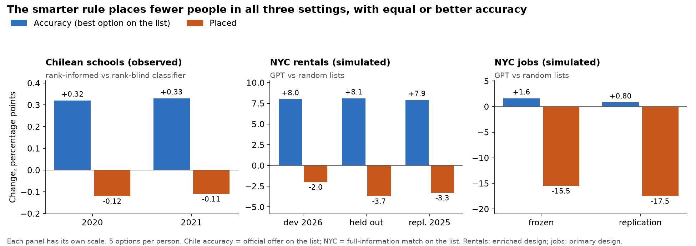
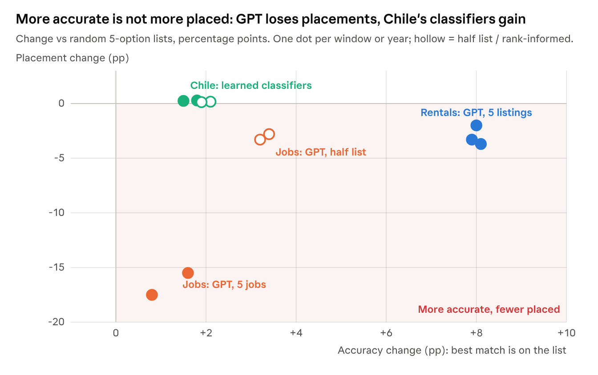
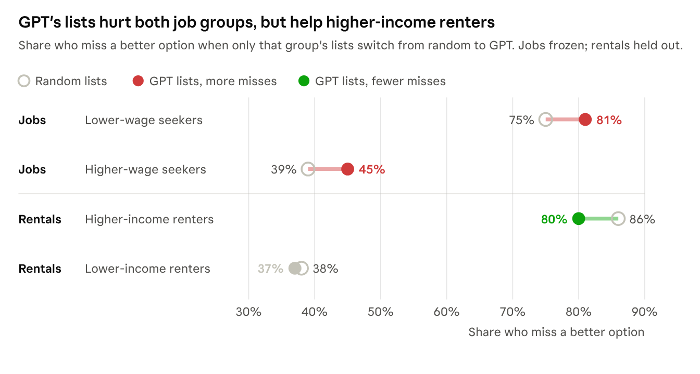

# Headline findings: LLM shortlists in NYC rentals, NYC jobs and Chilean schools

Short version. Full numbers, intervals and caveats are in [`README.md`](README.md).

**Setup.** `gpt-6-luna` picks 5 options per person; we compare against 5 random options on the same markets and clear the market with deferred acceptance. There are two simulation studies:
- **NYC rentals:** [`gpt-luna-rentals/`](gpt-luna-rentals/README.md), 3 windows.
- **NYC job postings:** [`jobs-gpt-frozen/`](jobs-gpt-frozen/README.md), Revelio data, frozen design plus a held-out replication.

Chilean school admissions ([`publication/research/observed/school/`](../publication/research/observed/school/README.md)) is an observed-data check that uses logistic classifiers, not an LLM.

1. **GPT's lists place fewer people in both NYC markets.** Placement falls 2–4 pp in rentals and 15–18 pp in jobs, in every window. The cause is concentration: lists pile onto the same few options, so they can't hold everyone. The capacity of the shown lists falls by 9–11 pp in rentals and about 20 pp in jobs. In rentals, fewer collisions win back about two-thirds of that, so the net loss is small; in jobs only about a fifth comes back. Reserving one slot per list fixes it: it erases the whole rental loss (anchored GPT matches or slightly beats random) and recovers 13–16 pp in jobs. This is the most constructive result, and it's a concrete version of the paper's capacity argument.

2. **The placement loss falls on whoever has the most options.** That's higher-income renters (46 feasible listings against 14), who lose about 6 pp. In jobs it's lower-wage seekers (about 21 feasible jobs against 11), who lose about 23 pp.

3. **"More accurate but places fewer" depends on the comparison.**
   - **Rentals:** it holds, with about +8 pp accuracy and −2 to −4 pp placed.
   - **Jobs:** GPT's 5-job lists are no more accurate than random, and the small edge disappears under calibration and in the replication. Only half-length lists show the pattern.
   - **Chile:** both classifiers beat random lists on accuracy *and* placement. The pattern appears only when stated rank is added to the model: more accurate, about 520 fewer placed per year.

4. **GPT widens the lower- vs higher-group gap in missing a better option (T), but for different reasons.**
   - **Rentals:** about +7 to +8 pp. GPT *helps* higher-income renters (misses 86% → 80%) and does nothing for lower-income renters.
   - **Jobs:** about +4 pp in markets drawn without oversampling, and not significant in the pre-specified stratified design. The group switch shows GPT *hurts both groups* through their own lists (lower-wage misses 75% → 81%, higher-wage 39% → 45%), so the harms roughly cancel in the gap.

5. **Repairs are cheap in jobs.**
   - **Repair cost:** the cheapest stable repair costs about the same under GPT as under random, and slightly less.
   - **Protection:** protecting lower-wage seekers from ending up worse off costs about 0 extra.
   - **Losers:** about 17% of seekers still end up worse off after the repair.

   These hold with one firm per seeker (the housing convention). The rental runs had no audits.

**Caveats.**
- All NYC outcomes are simulated.
- Timing of the jobs analyses (`jobs_manifest.json`, `later_additions`):
  - **T, group switch, protection premium:** named in the shared protocol before the jobs freeze.
  - **Accuracy and capacity/anchor:** added after the frozen-month results, but fixed before the held-out replication, which they then passed.
  - **Calibrated T and one firm per seeker:** fully post hoc.
  - **Rentals:** the accuracy and capacity analyses are equally post hoc there.
- Jobs T intervals are about ±3 pp, so small effects could be missed.
- "Missed a better option" and "placed" can move in opposite directions, so report both.

# LLM shortlists: strongest results

## The headline numbers

When gpt-6-luna picks the 5 options each person sees, fewer people get placed than with 5 random options. Reserving one slot per list mostly fixes it. Every number below is GPT minus random on the same markets, in percentage points, and holds in held-out months.

| Result | Number | Where |
| --- | --- | --- |
| Fewer job seekers placed | **−15.5 / −17.5** | Jobs, frozen / replication |
| Fewer lower-wage seekers placed | **−22.6 / −23.0** | Jobs, frozen / replication |
| More accurate, yet fewer renters placed | **+8 accuracy, −2 to −4 placed** | Rentals, 3 windows |
| Capacity of the shown lists cut | **−20 to −22** jobs; **−9 to −11** rentals | Both markets |
| One reserved slot wins back | **+13 to +16** jobs; **+3.5 to +4.9** rentals | Both markets |
| Anchored GPT vs plain random, rentals | **+1.5, +0.3, +1.6** (loss erased) | Rentals, 3 windows |
| Gap in missed better options widens (T) | **+7 to +8** rentals; **+4** jobs (natural draws) | Both markets |
| Rank-informed model vs rank-blind | **~520 fewer families placed a year** | Chile, observed data |

The jobs loss is about five times the rental loss. The mechanism is the same: GPT piles everyone onto the same few options.

## Concentration, and the one-slot fix

GPT's lists pile everyone onto the same few options, so the shown lists can't hold everyone. Reserving one of the 5 slots for an option from a full-market assignment brings placement back to about random in jobs, and slightly above random in rentals.

In jobs, GPT's top three postings take 37% of list slots against 27% under random lists.

## Accuracy is not placement, across all three studies

In each setting, the "smarter" rule places fewer people than the baseline in every year or window. Chile compares a rank-informed classifier with a rank-blind one; NYC compares GPT with random lists. Each panel has its own scale.

Against one shared baseline, random 5-option lists, GPT is the only recommender that lands in the "more accurate, fewer placed" corner. Chile's learned classifiers are more accurate *and* place slightly more families than random lists.

Jobs GPT 5-job lists are barely more accurate than random and lose the most placements, so concentration, not accuracy, drives the loss.

## Who pays: the group with more options

Long lists get concentrated, so the people with the most feasible options lose the most. The rule holds in all three settings, but it lands on different groups: Chilean families with more than 5 choices, higher-income renters and lower-wage job seekers.

Chilean families with 5 or fewer choices still lose a little, though their own lists never change: one person's list affects everyone else's chances.

In jobs the pay floor binds higher-wage seekers, so lower-wage seekers have the longer lists and bear the cost.

## Hidden harms: a near-zero gap can be two harms

In jobs, GPT hurts both wage groups through their own lists, and the two harms cancel in the gap. Switching one group's lists at a time shows it (the group switch):

- **Jobs:** both effects are significant. In the replication the lower-group effect is +9.1 [6.6, 11.5] and the higher-group effect is −6.5 [−8.9, −4.0], yet the gap (T) is only +2.6.
- **Rentals:** the opposite story. GPT *helps* higher-income renters (misses 86% → 80%) and does nothing for lower-income renters, so the gap widens by about 7 points.
- **No spillover:** in both markets the movement comes from a group's own lists, not from competition with the other group.

So "the gap didn't move" is not "no effect". Report each group, not just the gap.

## Observed check: Chilean school admissions

On real admissions data (915,638 applicant-years), adding stated rank to a classifier makes it more accurate but places about 520 fewer families a year. This is the same "more accurate, places fewer" pattern, with no simulation and no LLM.

- **Rank-informed minus rank-blind:** accuracy +0.32 / +0.33, placed −0.12 / −0.11 (2020 / 2021).
- **Spillover is real:** families whose own list never changed still lose a little placement when everyone else's list is recommended.
- **Contrast with GPT:** simple classifiers place *more* families than random lists (+0.28 / +0.24), while GPT places fewer than random in both NYC markets.