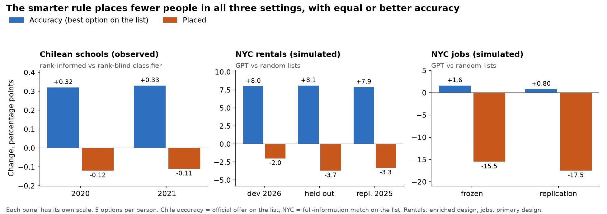
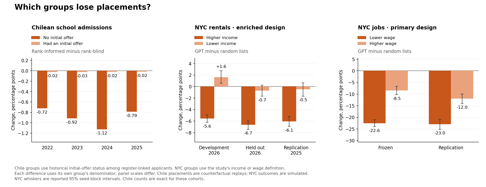

# Headline findings: recommended shortlists in NYC rentals, NYC job postings and Chilean school admissions

Two simulation studies ask the same question. When an LLM chooses the 5 options each person sees, how does the market turn out compared with 5 random options? Both use `gpt-6-luna` through the HUIT API Platform with the same settings (reasoning off, at most 300 tokens, every reply valid). Both use seeker-proposing deferred acceptance and test on held-out months. The Chile study uses classifiers trained on earlier administrative records and reconstructs allocations on later submitted reports. Its altered-menu placements are counterfactual replays (see *Chilean school admissions* below). Details and full tables:

- **Rentals:** [`gpt-luna-rentals/`](gpt-luna-rentals/README.md). StreetEasy-style listings × ACS renters, 64 × 64 markets. Windows: development (Jun–Aug 2026), held out (Sep–Oct 2026), replication (Jun–Aug 2025).
- **Rental coordination/access follow-up:** [`rental-anchor-access/`](rental-anchor-access/README.md). Reproduces all 1,280 markets and audits coverage, gross exits and stronger coordinated baselines; sufficient seed counts reproduce the intervals without private replay inputs.
- **Jobs:** [`jobs-gpt-frozen/`](jobs-gpt-frozen/README.md). Revelio postings × ACS seekers, 24 × 24 markets in 4 occupations. Windows: frozen (Aug–Oct 2025) and held-out replication (Nov–Dec 2025).
- **Earlier model:** [`claude-haiku-pilot/`](claude-haiku-pilot/README.md), the rental development run with Claude Haiku 5.5.
- **Schools:** [Current 2022–25 Chile results](chile/README.md), with administrative reports, initial offers and linked April enrollments. Two frozen 2019 classifiers select course menus. The original [2020–21 analysis](../publication/research/observed/school/README.md) remains an earlier benchmark with an official-offer target and pooled-seat approximation.

## The comparison in one table

GPT 5 options minus random 5 options, in percentage points, on the same markets. Ranges span the windows. Jobs intervals use seed-block resampling. Rental placement, capacity and T tables use seed blocks, while the separate `accuracy.txt` coverage check uses 2,000 market-bootstrap draws. See the source-specific methods below.

| | Rentals | Jobs |
|---|---|---|
| **Accuracy** (full-information match is on the list) | **+7.9 to +8.1**, all significant | **+1.6 / +0.8**, frozen only significant; −0.2 at calibrated weights |
| **Placed** (share matched from lists alone) | **−2.0 to −3.7** | **−15.5 / −17.5** |
| Placed, group with more options | higher-income −5.6 to −6.7 | lower-wage −22.6 / −23.0 |
| Placed, group with fewer options | lower-income +1.6 to −0.7 | higher-wage −8.5 / −12.0 |
| **T**, matched design (rental primary ↔ jobs natural) | +4.5, +3.6, +4.4 | +4.3 [1.9, 6.8] / +4.2 [0.5, 7.8] |
| **T**, oversampled design (rental enriched ↔ jobs stratified) | +8.5, +6.7, +8.1 | +0.8 / +2.6 (neither significant) |
| What the lists favour | pricier listings for higher-income renters (0.57 vs 0.50 percentile) | no salary steering (0.47 for both groups) |

The accuracy and placement rows use each study's headline design: rental enriched and jobs primary (stratified), the oversampled designs that the manifests pair. Rental values are development, held out and replication; jobs values are frozen / replication.

T is the change in the lower- minus higher-group gap in the share who miss a better option. A "better option" is a hidden blocking pair: an option they weren't shown, that would take them, and that they prefer.

## Three-way comparison with the current Chile results

Chile compares the rank-informed and rank-blind predictors on 2022–25 records. NYC compares GPT and random menus. Chile shows up to five discretionary courses plus any continuity entitlement. The NYC policies show up to five options.

- **Chile.** Coverage of the April enrollment school rises by 4,638 hits and replayed placement falls by 1,670, among 1,969,120 linked applicant-years. This is +0.236 and −0.085 percentage points. The actual initial assignment is reconstructed independently on all 2,044,649 applicants.
- **Rentals.** Full-information-match coverage rises by about 8 pp while placement falls by 2–4 pp in the enriched design.
- **Jobs.** Placement falls by 15–18 pp. The five-job coverage advantage is significant in the frozen sample and unresolved in the replication, whose interval includes zero.

The Chile panel groups pupils by whether they received an initial offer. Those without one are 7.4% of the linked sample and account for 76.0% of the net placement decline. The NYC panels use income or prior wage groups. These comparisons show who bears the cost in each market. They do not isolate list length as a causal driver.

Chile coverage uses all pupils with an April enrollment link. NYC coverage is conditional on having a full-information match, while NYC placement includes all people in the sampled market. Every panel uses its own scale. The individual counts and denominators are in the [Chile evidence package](chile/README.md), rental `accuracy.txt` and jobs `accuracy_pairs.csv` files. Rebuild the figures with `python scripts/three_way_charts.py findings`.

## Three findings

**1. GPT's displayed pairs support fewer simultaneous matches in both markets.** On five-option lists, GPT places fewer people than random in every window of both studies. The jobs loss is about five times larger. These markets differ in supply, preferences and the fraction of feasible options shown. The cross-domain comparison does not identify which difference explains the larger jobs effect.

**The capacity decomposition accounts for the placement difference in both markets** (jobs: `jobs-gpt-frozen/`; rentals: [`rental-capacity-gpt/`](rental-capacity-gpt/README.md)).

| GPT vs random, pp | Rentals, enriched (3 windows) | Jobs, primary (frozen / replication) |
|---|---|---|
| Capacity of the shown lists | −8.8 to −10.6 | −19.7 / −22.4 |
| Shortfall (what deferred acceptance misses) | −6.3 to −7.3 | −4.1 / −4.9 |
| Placed | −2.0 to −3.7 | −15.5 / −17.5 |
| One reserved slot: gain | +3.5 to +4.9 | +13.0 / +15.9 |
| Anchored GPT vs plain random | +1.5, +0.3, +1.6 | −2.6 / −1.5 |

- **Capacity:** in both markets GPT's lists cut maximum matching size sharply. In jobs, GPT's top three postings take 37% of slots against 27% under random, consistent with concentration contributing to this loss.
- **Offset:** the gap between maximum matching and deferred-acceptance placement shrinks under GPT. This arithmetic offset is larger in rentals. The decomposition alone does not identify an independent causal effect of concentration.
- **Reserved slot:** it recovers the rental loss in mean enriched placement and most of the jobs loss. The anchor uses all feasible pairs to construct a maximum matching. The [rental access follow-up](rental-anchor-access/README.md) finds gross exits in all six window/design cells, so the gain is not an individual retention guarantee. Jobs anchor coverage and exits remain unmeasured because the original inputs and menus were unavailable for this follow-up.

**The stronger coordinated comparison changes the conclusion.** In the rental follow-up, Balanced + GPT places 6.61–12.83 pp more people than Anchor + GPT while covering 3.05–6.06 pp fewer full-information assignments. Both signs exclude zero under the eight-endpoint simultaneous intervals in each of the six cells. The policies have the same menu sizes and information, but Balanced + GPT may replace several options rather than at most one. It beats random on both mean outcomes in all six cells. The result is a tradeoff between these coordinated policies, not evidence that every improvement must sacrifice placement or coverage. The follow-up is post hoc and uses the original modeled preferences. [Full comparison, transitions and reproducible counts](rental-anchor-access/README.md)

The paper's own learned rental model shows the same rental pattern (`publication/research/observed/capacity/`).

**2. The group with more feasible options has the larger decline in these NYC simulations.**
- **Rentals:** higher-income renters average 46 feasible listings against 14. They lose 6 to 7 points of placement, while lower-income renters barely move.
- **Jobs:** the pay floor reverses this. Lower-wage seekers have about 21 feasible jobs against 11, and they lose about 23 points.

The ordering reverses between the two NYC domains. Feasible-set size is one possible explanation, and a controlled comparison holding other attributes fixed remains to be done.

**3. GPT widens the group gap in missed better options when markets are drawn as they come; with oversampling it's mixed.**
- **Natural draws:** in markets drawn without oversampling (rental primary, jobs natural), T is +3.6 to +4.5 in every window of both studies. At the jobs calibrated weights it is +3.6 / +3.0 [−0.7, 6.5].
- **Oversampled designs:** the two studies diverge.
  - **Rentals:** in the enriched design, T grows to about +8. Nearly all of it comes from GPT changing higher-income renters' lists.
  - **Jobs:** in the stratified design, GPT raises misses for both wage groups by about the same amount, so the gap barely moves.

**The group switch shows why the markets differ.** Each group's lists are switched between random and GPT separately (S_L + S_H = T; rental `*/group_switch.csv`, jobs `jobs-gpt-frozen/group_switch.csv` and `replication/group_switch.csv`).

| Share who miss a better option | Rentals (held out, enriched) | Jobs (frozen, primary) |
|---|---|---|
| Higher group, own lists switched to GPT | 86% → **80%** (GPT helps) | 39% → **45%** (GPT hurts) |
| Lower group, own lists switched to GPT | 38% → 37% (no change) | 75% → **81%** (GPT hurts) |
| Cross-group effects | depend on the other group's policy | depend on the other group's policy |
| S_L / S_H (pp) | −0.6 / **+7.3** | **+6.6** / **−5.8** |
| T | +6.7 | +0.8 |

- **Rentals:** higher-income renters have a lower missed-option rate under the displayed own-list comparison. A lower hidden-blocking-pair rate alone does not establish better placement or higher utility.
- **Jobs:** GPT's lists *hurt* each wage group through its own lists, by similar amounts. The replication gives S_L +9.1 [6.6, 11.5] and S_H −6.5 [−8.9, −4.0], with T +2.6.

The two contributions have opposite signs and largely cancel in the jobs gap. They are Shapley contributions to the gap, each incorporating direct and cross-group changes. In the frozen jobs sample, switching lower-wage menus when higher-wage menus already use GPT raises the higher-wage missed-option rate by 2.71 pp. The reverse switch raises the lower-wage rate by 2.81 pp. These conditional cross-effects have no separate confidence intervals in the aggregate release. [Four policy combinations](jobs-gpt-frozen/group_switch.csv)

## Accuracy is not the same thing as placement

The team's claim was that a recommender can be more accurate and still place fewer people.
- **Rentals:** it holds cleanly against random lists.
- **Jobs:** half-length lists show positive coverage and negative placement differences in both windows (+3.4 / +3.2 coverage, −2.8 / −3.3 placed). Five-job lists improve coverage by 1.6 pp in the frozen sample. The replication estimate is +0.8 pp with an interval spanning −1.4 to +3.3 pp, leaving that coverage comparison unresolved.
- **Schools:** the current institutional replay shows the tradeoff between the two classifiers. Against first-five, the rank-informed classifier improves both outcomes overall. The earlier pooled-seat study also found both classifiers ahead of random on both outcomes.

## Chilean school admissions

The current results include four application cohorts, 2022–25, and reconstruct the course or no-offer result in all 2,044,649 released initial assignments. Under counterfactual menus, the rank-informed predictor covers more historically attended schools and leaves fewer pupils placed than the rank-blind predictor. [Chile headline results, denominators and reproduction](chile/README.md)

| Outcome across 1,969,120 linked applicant-years | Rank-informed minus rank-blind |
| --- | ---: |
| April enrollment school appears on the menu | +4,638 |
| Pupils placed in the replay | −1,670 |
| Pupils with no initial offer: placements | −1,270 |
| Pupils with no initial offer: April-school coverage | −43 |

The third row is 76.0% of the net placement decline, borne by a group making up 7.4% of the linked sample. The study's independent 2021 entry-grade replay locates 237 of 309 net lost placements among people whose own menu stays unchanged. A related randomized school-advice trial supplies evidence about family response, but it did not evaluate these two predictors.

The baseline matters. Against the family's first five discretionary courses, the rank-informed predictor gains 9,800 April-school hits and 8,143 placements overall, while the group with no initial offer loses 2,860 placements. The earlier 2020–21 official-offer comparison against random lists remains in the [original source study](../publication/research/observed/school/README.md). Its target, cohorts and allocation model differ from the extension above.

The theoretical contribution concerns protection before assignment. Within the fixed common/union menu family, on three panels of 1,024 lotteries, preserving exact courses and seat types permits 314 additional historical hits. Preserving each recipient's seat while allowing school changes permits at least 642, with a certified upper bound of 4,620. These are hindsight bounds on the finite design panel. The corresponding target-gain decision problem is NP-complete on an explicit panel. Two rules using pre-assignment data were frozen and tested on fresh lotteries. The rule with an all-order guarantee under the reconstructed mechanism gains 28 historical hits and has no incumbent exits. The learned rule gains 50 and incurs one exit on each held-out generator. These modest gains and the open optimization gap should accompany the constructive result. [Theory and tests](chile/README.md)

## Repair, protection and audit costs (jobs only)

The rental runs report no audits. In the jobs markets:
- **Repair cost:** the cheapest stable repair costs about the same under GPT as under random (3.7–3.8 vs 3.9 firms).
- **Protection:** preventing additional avoidable losses for lower-wage seekers, or all seekers, costs essentially nothing extra. The protected set excludes people who are worse off even under full-information, seeker-optimal stable matching; see [`protection_sets`](../hiddenoptions/audit.py).
- **Losers:** about 16–17% of seekers belong to that excluded set and receive a worse outcome after the repair, which can include becoming unmatched. Thus the near-zero premium does not establish protection for every first-round recipient. Chile's seat-retention requirement includes every incumbent, but permits a different school and does not guarantee a preferred school.

These results use synthetic six-person seeker-side agents. The one-firm-per-seeker check below tests them under the housing convention: costs rise, but every conclusion holds.

### One firm per seeker (sensitivity)

The housing side gives every renter a private firm. This check gives every job seeker one too (`seeker_firm_size: 1`), replacing the synthetic six-person agents: so auditing a seeker means overriding the recommender for that one person. Setup:
- **Scope:** primary variant, both windows, no API calls (GPT answers reused).
- **Unchanged inputs:** seekers, postings, preferences and GPT's lists.
- **Redrawn:** the random and rule-based lists, because their random seed comes from the market ID.

Tables are in `jobs-gpt-frozen/firm1/`.

| Exact repair cost (firms) | Six-person agents | One firm per seeker |
|---|---|---|
| Firms per market | 12.1 | 32.1 |
| GPT 5 jobs vs random, frozen | 3.67 vs 3.86 (−0.19 [−0.24, −0.13]) | 5.66 vs 6.12 (**−0.46** [−0.55, −0.35]) |
| GPT 5 jobs vs random, replication | 3.80 vs 3.87 (−0.07 [−0.12, −0.02]) | 6.04 vs 6.34 (**−0.31** [−0.49, −0.11]) |
| Who gets audited, GPT 5 jobs (frozen) | 3.1 seeker agents + 0.6 employers | 0.8 seekers + 4.9 employers |
| Worse off after repair, GPT / random | 17% / 24% | 17% / 25% |
| Protection premium, excluding unavoidable losers | ≈ 0 | ≈ 0 (at most 2 firms, in < 3% of markets) |

- **Repairs cost more:** they go from about 4 firms to about 6. They also switch from overriding seekers to auditing employers, because overriding one person now buys much less.
- **GPT stays cheaper to repair than random,** and its advantage grows (−0.46 and −0.31 firms). Every optimum was certified, and every plan passed the stability check.
- **No change:** who ends up worse off, and the near-zero cost of preventing additional avoidable losses.
- **Not affected at all:** placement, accuracy, T and the capacity results don't involve audits, so firm grouping doesn't change them.

## What differs between the two GPT studies

| | Rentals | Jobs |
|---|---|---|
| Market size | 64 × 64 | 24 × 24 |
| Groups | income below/above the median | prior wage below/above the NYC median ($58,657) |
| The cap that binds | rent cap binds lower-income renters | pay floor binds higher-wage seekers |
| Preferences | calibrated | uncalibrated frozen primary; calibrated sensitivity gives the same placement and T pattern |
| T cell weights | borough ACS shares | occupation × month cells weighted equally |
| Audits | none (no-audit runs) | full set of exact and heuristic methods |
| Seeker-side firms | one per renter | six-person agents in the frozen design; one per seeker as a sensitivity check |
| Other arms | Claude Haiku 5.5, honest ranker | honest ranker, half-length lists, steering rules (not allowed: Claude, under the Revelio terms) |
| Published replies | yes (gzipped) | no (Revelio terms: aggregates only) |

## Open
- **Missed better options are not the same as placement:** "miss a better option" and "placed" can move in opposite directions. In rentals, GPT cuts higher-income renters' misses while also cutting their placement (finding 2). Report both, and don't read T as a welfare measure on its own.
- **What was pre-specified:**
  - **Protocol estimands:** T, the group switch and the protection premium were named in the shared protocol (`EXPERIMENT_SETUP.md`) before either GPT study ran.
  - **Accuracy and capacity/anchor:** added after results in both studies (`rental_accuracy.py`; the paper's own capacity follow-up). In jobs they were committed before the held-out replication. Placement loss (−17.5 pp), the ratio of capacity loss to placement loss (1.28), and anchor recovery (+15.9 pp) repeat there. The five-job coverage advantage remains uncertain.
  - **Rest:** calibrated T, one firm per seeker and the rental capacity check (`rental-capacity-gpt/`) are post hoc.
  - **Rental coordination/access audit:** the stronger baselines, gross transitions and new seed-block intervals in `rental-anchor-access/` reuse all three known windows and are also post hoc.
  - **Record:** details are in `jobs_manifest.json` under `later_additions`.
