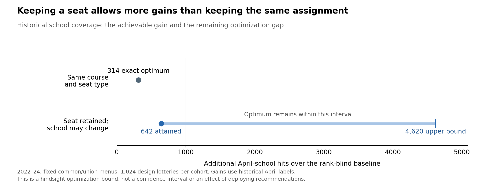

# Chile: results for the paper and presentation

The clearest result is about who loses a place. Adding submitted rank to an offer predictor improves coverage of pupils' later enrollment schools, yet reduces placement in the replay. Pupils who had no historical initial offer bear most of that decline. Allowing recommendations to change while protecting each recipient's seat creates a different optimization problem from maximizing prediction accuracy or total placement.

This folder brings the Chile results into the team's PR #8 findings. It contains public aggregates from the [paper branch at commit `75830f6`](https://github.com/ikhillan/CS2880-final-project/tree/75830f6c4f5d210def18920f92db3a2100c93ca6/publication/two-studies), not a new experiment. The source files and their hashes are recorded in [provenance.json](provenance.json).

## The comparison and its limits

Two logistic classifiers, trained on 2019 applications, select menus from submitted courses. Both predict the historical initial offer; one also uses submitted rank. We retain up to five discretionary courses and any protected continuity option, then run the reconstructed admissions mechanism. The evaluations below use 2022–25 application cohorts and the following April's enrollment registers.

An **April-school hit** means that a pupil's historically attended school appears on the menu. It does not mean the pupil receives that school in the replay. A **placement** means a seat in the replay, not observed enrollment under a deployed recommender. April enrollment is an outcome of the historical system, not an independently elicited preference or a measure of welfare. Reports and supply are held fixed in these comparisons.

The mechanism reproduces the released course or no-offer result for all **2,044,649 audited applicant-years**. Coverage is evaluated among **1,969,120 applicant-years** linked to an April enrollment. A pupil can appear in more than one application year. Historical agreement is a check of reconstruction; it cannot validate every counterfactual menu or behavioral response. [Fidelity counts](historical_fidelity.csv) · [Institutional method and reproduction](https://github.com/ikhillan/CS2880-final-project/blob/75830f6c4f5d210def18920f92db3a2100c93ca6/publication/two-studies/institutional/README.md)

| Application year | Linked applicant-years | Additional April-school hits | Change in placements |
| --- | ---: | ---: | ---: |
| 2022 | 549,997 | +1,007 | −441 |
| 2023 | 516,921 | +1,198 | −479 |
| 2024 | 457,231 | +1,385 | −440 |
| 2025 | 444,971 | +1,048 | −310 |
| **Total** | **1,969,120** | **+4,638** | **−1,670** |

All differences above compare rank-informed with rank-blind menus on the linked sample. The pooled changes are **+0.236 percentage points of coverage** and **−0.0848 points of placement**. There are 2,397 gross exits and 727 entrants. Across the full audited population, including pupils without an enrollment link, the placement change is −1,834. Keep those denominators separate. [Cohort table](cohort_comparison.csv) · [Full-population transitions](all_population_spillovers.csv)

The alternative baseline must appear beside this result. Against the family's **first five discretionary courses**, the rank-informed menus gain **9,800 hits and 8,143 placements** overall on the same linked sample. The prediction–placement tradeoff therefore describes a particular comparison, not an inevitable effect of improving predictions. The older 2020–21 analysis used an official-offer target and a pooled-seat approximation; its estimates should not be mixed into these four cohorts.

## Who bears the decline?

The 145,450 linked pupils with **no historical initial offer** are **7.39% of the sample**. They account for **1,270 of the 1,670 net lost placements (76.05%)** against rank-blind menus. Their own April-school coverage falls by 43 hits. Against first-five they lose 2,860 placements even though total placement improves. These groups are defined by historical outcomes, after policies are fixed; they are not risk groups available to a prospective rule. [Group counts and denominators](group_comparison.csv)

In the separate 2021 entry-grade replay, **237 of 309 net placement losses occur among pupils whose own menu is unchanged**. That is evidence of interference within the replay: other applicants' menus can affect a pupil's outcome. Public records do not identify the treatment arms of the related school-advice field experiment, so this is not an estimate of that experiment's effect. [Entry-grade summary](field_cohort.csv) · [Field evidence and identification limits](https://github.com/ikhillan/CS2880-final-project/blob/75830f6c4f5d210def18920f92db3a2100c93ca6/publication/two-studies/field-validation.tex)

## What must a protection rule guarantee?

Let $A$ be the rank-blind baseline menu policy, $D$ a proposed policy, and $M_A^s(i)$ and $M_D^s(i)$ the assignments of pupil $i$ on the same lottery draw $s$. Write $\bot$ for no seat. Define gross exits by

$$
X_s(D)=\sum_i\mathbf{1}\{M_A^s(i)\ne\bot,\ M_D^s(i)=\bot\}.
$$

Seat retention requires $X_s(D)=0$ for every specified draw. A recipient can switch schools, and a formerly unplaced pupil can enter. Retaining a seat does not guarantee a school the pupil likes as much. The constraint covers all baseline recipients, including pupils without an April enrollment link.

For a fixed panel of lotteries, the problem is

$$
\operatorname{OPT}_{\mathrm{retain}}
=\max_{D\in\mathcal D}\{H(D)-H(A):X_s(D)=0\text{ for every }s\},
$$

where $H$ counts linked pupils whose historical April school is shown. If $B$ is the rank-informed policy, the allowed menu family $\mathcal D$ requires $A_i\cap B_i\subseteq D_i\subseteq A_i\cup B_i$ and $|D_i|=|A_i|$ for each pupil. Common continuity entitlements stay; course order follows the report and the specified family promotions. One menu policy must work across the entire panel. Using evaluation-year April labels makes this a **hindsight benchmark**, not an implementable scoring rule.

The distinction from aggregate capacity matters. Suppose A prefers school x to y, B lists only x, both schools have one seat, and x ranks A above B. The displayed graph admits A→y and B→x, seating both. Deferred acceptance instead gives x to A and leaves B unplaced. An anchor from a maximum matching therefore supplies no general seat-retention guarantee.

In the fixed-priority, strict responsive benchmark, stable assignment witnesses yield an exact integer formulation of retention. The target-gain decision problem is NP-complete on an explicitly supplied panel, even with unit seats, one common priority order per draw, menus of length at most three, and one binary substitution per editable pupil. This hardness statement does not assume a particular Chilean lottery distribution. The institutional calculations separately retain grade order, family links and seat categories. [Formulation and reduction](https://github.com/ikhillan/CS2880-final-project/blob/75830f6c4f5d210def18920f92db3a2100c93ca6/publication/two-studies/retention-theory.tex)

## How much does allowing school switches buy?

On the same **1,024 design lotteries per cohort**, over 2022–24:

| Protection requirement | Additional historical April-school hits |
| --- | ---: |
| Preserve every baseline course and seat type | Exact optimum: **314** |
| Retain every incumbent's seat, allowing school switches | Achieved: **642**; upper bound: **4,620** |
| No assignment-protection constraint | Exact optimum: **4,823** |

Thus **$642\le\sum_{y=2022}^{2024}\operatorname{OPT}_{\mathrm{retain},y}\le4,620$**. Allowing switches more than doubles the demonstrated gain relative to exact-contract preservation. The remaining gap is large. The bounds are not confidence intervals, and a certificate on the design panel does not establish retention on an unseen lottery. The constructed 642-hit solution loses no old coverage hit; the general optimization problem allows such losses when net coverage increases. [Annual bounds and allocation checks](retention_bounds.csv) · [Full argument](https://github.com/ikhillan/CS2880-final-project/blob/75830f6c4f5d210def18920f92db3a2100c93ca6/publication/two-studies/retention-evidence.tex)



## What works before assignment?

Both tested rules use ministry-side information available after reports and special-priority inputs arrive, before the ordinary lottery. Neither chooses menus using the current cohort's realized ordinary tie-breaks, initial offers or April outcomes. The learned rule is calibrated on 2021 applications and April 2022 enrollment, then held fixed across the evaluation cohorts. The rules were frozen before opening fresh lottery panels for the **same three applicant cohorts**; these are held-out lotteries, not new populations.

| Rule | Net historical hit gain | Incumbent exits on 384 matched-course test draws | Incumbent exits on 96 school/family-ticket test draws |
| --- | ---: | ---: | ---: |
| Structural rule with all-order retention proof | **+28** | **0** | **0** |
| Learned rule certified on the design panel | **+50** | **1** | **1** |

The structural rule identifies common options that guarantee a seat under any permitted ordinary lottery order. It freezes the relevant competitor and family interactions around pupils without such guarantees, and fills the remaining allowed menu positions using submitted rank. The proof covers every strict ordinary tie ordering under the reconstructed mechanism and its fixed inputs. The held-out draws check its implementation.

The learned rule had zero exits on its design panel, yet fails to retain an incumbent in each test generator. Its +50 hits consist of 134 gains and 84 lost hits; the structural rule's +28 consist of 115 gains and 87 losses. These coverage gains are scored once on the fixed historical records and must not be added across the two lottery generators. Exits, entrants and school switches summed across draws count simulated pupil–draw events, which can repeatedly involve the same pupil.

Neither rule changes historical coverage for pupils with no initial offer. The structural rule also generates no entrants on the two paired test panels. The result establishes a useful protection mechanism, but does not yet demonstrate improved access for the group bearing most of the replay's loss. [Policy summaries](prospective.csv) · [Every paired test draw](prospective_draws.csv) · [Proof, learning method and tests](https://github.com/ikhillan/CS2880-final-project/tree/75830f6c4f5d210def18920f92db3a2100c93ca6/publication/two-studies/retention)

## How this fits the NYC results

The common question is whether a recommendation system can improve individual relevance while preserving simultaneous feasibility and protecting recipients. NYC supplies large placement losses under GPT menus and a constructive capacity-aware anchor. Chile supplies observed reports, a reconstructed institutional mechanism, and an individual seat-retention requirement. These are complementary tests with different information, targets and assumptions.

The next experiment should evaluate the NYC anchor's **gross exits, entrants and rank changes**, paired to its unanchored baseline on the same markets. Compare random, GPT, anchored random and anchored GPT using the same feasible graph and capacities. Report placement and reference-option coverage separately, including group outcomes. Then test whether a retention-constrained alternative can recover the aggregate gain while keeping every previous recipient placed. This addresses a precise gap between the current anchor results and the Chile theory. More language-model calls alone would not resolve it.

For the presentation, use the cross-market plots to introduce the problem, the 7.39% / 76.05% result to show the distributional stakes, and the 314 / 642–4,620 comparison to explain the mathematical question. End with the prospective +28 / +50 results and the protection failures. The contribution is clearer when the unresolved access problem is visible.

## Reproduce the presentation tables

From the repository root:

```sh
python3 findings/chile/rebuild.py
python3 scripts/chile_headline_charts.py
python3 scripts/three_way_charts.py findings
```

The first command uses the standard library. It checks all 35 source CSV hashes against the provenance manifest for the pinned commit, checks accounting and agreement across archived tables, and rebuilds eight summaries. It also checks that the two prospective rules use identical held-out lotteries and baseline placements. The figures require Matplotlib and NumPy. These commands reproduce the aggregate presentation evidence; they do not rerun admissions from individual ministry records. Full reconstruction instructions remain in the pinned paper branch. No pupil records or restricted jobs data are included here.
